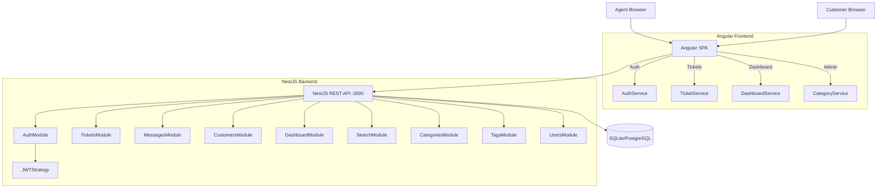
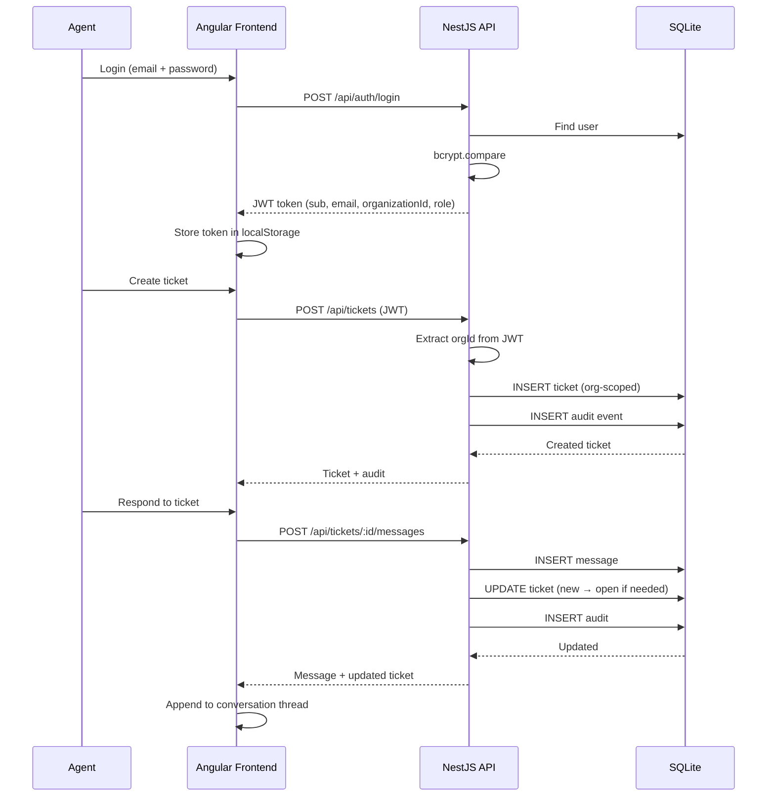

# Architecture

## System Diagram

## Data Flow

## Architecture Decisions

### Monorepo Structure
The project uses a simple monorepo with `apps/api` (NestJS) and `apps/web` (Angular). Each has its own `package.json`, `tsconfig.json`, and build pipeline. The root contains documentation and the `.gitignore`.

### Multi-Tenant Architecture
Every entity is scoped by `organizationId`. JWT payload includes `organizationId` and `role`. Every controller extracts the orgId from the current user and passes it to every service method. This ensures data isolation between organizations.

### Status Machine
The ticket lifecycle is enforced server-side with valid transitions:
- `new → open` (agent takes ticket)
- `open → in_progress` (agent working)
- `in_progress → resolved` (solution proposed)
- `resolved → closed` (customer confirms)
- `closed → open` (reopen)
- `open → closed` (direct close)

Invalid transitions return 400 Bad Request.

### Separated Detail Tables
Messages, tags, and audit events are stored in separate tables (not JSON blobs on Ticket) to enable ordering, querying, and future extensions.
