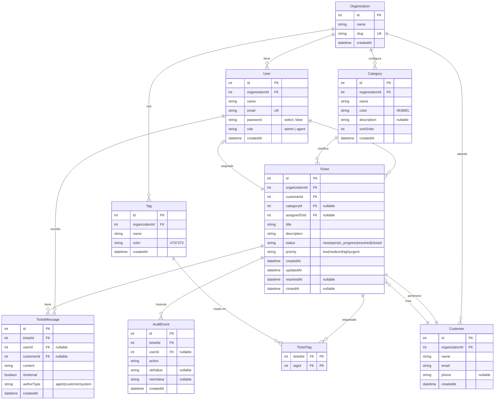

# Database Schema

## ER Diagram



## Migration Strategy

TypeORM `synchronize: true` is used for development. For production, use TypeORM migrations or a dedicated migration tool. The schema is PostgreSQL-compatible.

## Key Queries

### Dashboard KPIs (SQLite-compatible)

```sql
-- Tickets by status
SELECT status, COUNT(*) as count FROM tickets
WHERE organizationId = ? GROUP BY status;

-- Active tickets by priority
SELECT priority, COUNT(*) as count FROM tickets
WHERE organizationId = ? AND status NOT IN ('resolved', 'closed')
GROUP BY priority;

-- Average resolution time (hours)
SELECT COALESCE(AVG(
  (strftime('%s', resolvedAt) - strftime('%s', createdAt)) / 3600.0
), 0) as avgHours FROM tickets
WHERE organizationId = ? AND status = 'resolved' AND resolvedAt IS NOT NULL;
```

### Urgent Unassigned Tickets

```sql
SELECT t.*, c.name as customerName FROM tickets t
JOIN customers c ON c.id = t.customerId
WHERE t.organizationId = ? AND t.priority = 'urgent'
AND t.assignedToId IS NULL AND t.status NOT IN ('resolved', 'closed')
ORDER BY t.createdAt ASC;
```

### Filtered Ticket List

```sql
SELECT t.*, c.name as customerName, u.name as agentName
FROM tickets t
LEFT JOIN customers c ON c.id = t.customerId
LEFT JOIN users u ON u.id = t.assignedToId
WHERE t.organizationId = ?
ORDER BY CASE t.priority
  WHEN 'urgent' THEN 0 WHEN 'high' THEN 1
  WHEN 'medium' THEN 2 WHEN 'low' THEN 3
END ASC, t.createdAt DESC
LIMIT ? OFFSET ?;
```

## Neon/PostgreSQL Compatibility

The schema uses:
- `text` for strings (maps to TEXT in SQLite, VARCHAR/TEXT in PostgreSQL)
- `real` for decimals (maps to REAL in SQLite, DOUBLE PRECISION in PostgreSQL)
- `COALESCE` for safe aggregation (supported in both)
- `strftime` for date functions (SQLite) — use `EXTRACT` for PostgreSQL

For PostgreSQL migration, update date functions in dashboard queries.
